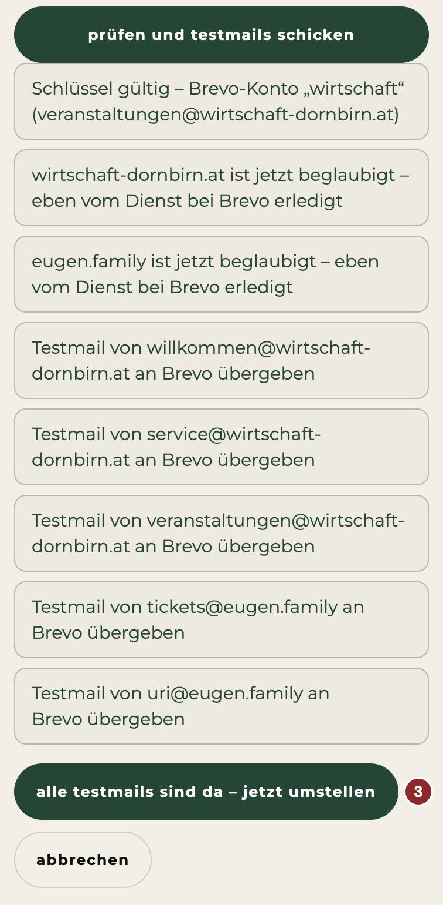
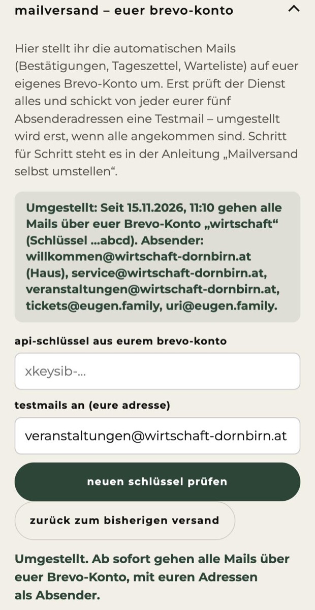

# Mailversand selbst umstellen · Anleitung für Sarah und Hannah

Stand 16. November 2026. **Worum es geht:** Die Mails der Webseite – Bestätigungen für Gäste,
Takeaway, Warteliste und der Tageszettel – kommen heute noch von einer
privaten Adresse von Jonas. Darum landen sie oft im Spam. Nach dieser
Anleitung kommen sie von euren eigenen Adressen, zum Beispiel
`service@wirtschaft-dornbirn.at`.

- **Wer:** eine von euch beiden – wer sich bei Brevo anmelden kann. Jonas
  braucht ihr dafür nicht.
- **Dauer:** etwa 20 Minuten.
- **Kosten:** keine.
- **Risiko:** keines. Umgestellt wird erst ganz am Ende, nach einer Probe.
  Bis dahin läuft alles wie bisher, und mit einem Knopf geht es jederzeit
  zurück.

## So läuft es ab

1. **In Brevo einen Schlüssel erzeugen.** Etwa 5 Minuten.
2. **Den Schlüssel in der Wirt-Ansicht einfügen und prüfen lassen.** Dabei
   beglaubigt die Webseite eure Domains bei Brevo selbst. Etwa 2 Minuten.
3. **Im Postfach fünf Testmails ansehen und umstellen.** Etwa 5 Minuten.
4. **In Brevo die IP-Sperre ausschalten.** Etwa 2 Minuten.

Am besten druckst du diese Anleitung aus und hakst mit dem Stift ab: Vor
jedem Punkt steht ein Kästchen. Am Bildschirm lassen sich die Kästchen nicht
anklicken.

## Bevor du anfängst

- [ ] Du kannst dich bei **Brevo** anmelden – in euer Konto, das Sarah Anfang
  November angelegt hat.
- [ ] Du kommst an den **Bestätigungscode** von Brevo. Er kommt per Mail an
  die Adresse, mit der ihr euch bei Brevo anmeldet. Bekommt ihr schon beim
  Anmelden jedes Mal einen Code aufs Handy, kommt er auf demselben Weg.
- [ ] Du hast ein Gerät, auf dem die **Wirt-Ansicht** läuft (Handy, Tablet
  oder Laptop).
- [ ] Du kannst in ein **Postfach** schauen, zum Beispiel
  `veranstaltungen@wirtschaft-dornbirn.at`. Dorthin gehen gleich fünf
  Testmails.

**Mach alles auf dem Gerät, auf dem die Wirt-Ansicht läuft.** Öffne Brevo dort
im Browser. Dann kopierst du den Schlüssel in Brevo und fügst ihn gleich in
der Wirt-Ansicht ein – er muss nirgends sonst hin.

## Schritt 1 – In Brevo einen Schlüssel erzeugen

Der Schlüssel ist eine lange Zeichenfolge. Mit ihm darf die Webseite über
euer Brevo-Konto Mails verschicken. Er ist geheim wie ein Passwort. Auf
dieser Seite zeigt Brevo die Knöpfe meist auf Englisch – die deutsche
Übersetzung steht jeweils in Klammern.

1. [ ] Im Browser diese Adresse öffnen:
   [app.brevo.com/settings/keys/api](https://app.brevo.com/settings/keys/api).
   Fragt Brevo nach der Anmeldung: anmelden. Du landest auf der Seite
   **API-Schlüssel & MCP** (API Keys & MCP). Klappt der Link nicht: in Brevo
   im Menü (am Laptop unten links) **Einstellungen** (Settings) →
   **SMTP & API** → **API-Schlüssel & MCP**.
2. [ ] Auf **Generate API key** (API-Schlüssel generieren) klicken.
3. [ ] Brevo will jetzt den Bestätigungscode mit 6 Ziffern (wohin er kommt,
   steht unter „Bevor du anfängst“). Den Code eintippen und auf **Verify**
   (Bestätigen) klicken. Kommt nichts: eine Minute warten, dann den Code
   noch einmal anfordern.
4. [ ] Bei **Key name** (Name) eintragen: `Webseite wirtschaft-dornbirn` und
   das heutige Datum, zum Beispiel `Webseite wirtschaft-dornbirn 16.11.2026`.
5. [ ] Bei **Expiry** (Ablauf) **No expiration** (kein Ablaufdatum) wählen.
6. [ ] Bei **Access** (Zugriff) **Restricted** (eingeschränkt) wählen.
   Darunter steht bei **Permissions** (Rechte) eine Liste mit vielen Zeilen.
   Du änderst **genau zwei** davon, alle anderen bleiben auf **None**:

| In dieser Zeile | wählst du |
| --- | --- |
| **Transactional email** | **All** |
| **Account** | **Read/write** |

7. [ ] Auf **Generate** (Generieren) klicken. Jetzt steht der Schlüssel da.
   Er beginnt mit `xkeysib-`.
8. [ ] Darunter ist der Schalter **Create MCP server API key**. Nicht
   anrühren, er bleibt aus – sonst schaltet Brevo diesen Schlüssel ab.
9. [ ] Den ganzen Schlüssel **kopieren** – mit dem Kopier-Symbol daneben,
   falls Brevo eines zeigt. Beim Markieren mit dem Finger erwischt man leicht
   nur ein Stück. Brevo zeigt den Schlüssel nur dieses eine Mal: Das Fenster
   offen lassen, noch nicht auf **I've saved my key** klicken, und gleich mit
   Schritt 2 weitermachen.

**Den Schlüssel nie weitergeben** – nicht per Mail, Chat oder Foto, auch nicht
an Jonas. Er gehört nur in die Wirt-Ansicht.

## Schritt 2 – Den Schlüssel in der Wirt-Ansicht prüfen lassen

1. [ ] Die Wirt-Ansicht öffnen und unten auf **haus** tippen.
2. [ ] Ganz nach unten scrollen: Fast am Ende steht **Mailversand – euer
   Brevo-Konto** (den roten Knopf „Tag leeren“ weiter oben nicht drücken).
   Darauf tippen, der Kasten klappt auf. Steht der Punkt nicht da: die
   Wirt-Ansicht neu laden oder die App schließen und wieder öffnen.

3. [ ] Bei **API-Schlüssel aus eurem Brevo-Konto** den Schlüssel einfügen.
4. [ ] Bei **Testmails an** die Adresse eintragen, in die du gleich
   hineinschaust. Das graue „z. B. …“ im Feld ist nur ein Beispiel – tipp die
   Adresse selbst ein.
5. [ ] Auf **Prüfen und Testmails schicken** drücken und ein paar Sekunden
   warten.

**Das siehst du jetzt:** eine Liste mit acht Zeilen und darunter den Knopf
**Alle Testmails sind da – jetzt umstellen**. Den noch nicht drücken – erst
siehst du in Schritt 3 die Testmails an. Bei den beiden Domains steht
„eben vom Dienst bei Brevo erledigt“ – oder nur „ist beglaubigt“, wenn das
schon früher geschehen ist. Die Webseite beglaubigt dabei eure beiden
Domains selbst bei Brevo – in Brevo musst du dafür nichts anklicken.
Das Schlüsselfeld ist wieder leer; das ist richtig so.

**Steht eine Zeile in Rot?** Dann stimmt noch etwas nicht. Was zu tun ist,
steht direkt darunter und im Abschnitt „Wenn etwas rot ist“. Am laufenden
Versand hat sich nichts geändert.

## Schritt 3 – Testmails ansehen und umstellen

1. [ ] Das Postfach öffnen, das du bei **Testmails an** eingetragen hast.
   Auch im **Spam-Ordner** nachsehen.
2. [ ] Dort sind **fünf Testmails**, Betreff „Testmail 1 von 5 – Absender …“
   bis „Testmail 5 von 5 – Absender …“. Als Name steht bei allen „Wirtschaft
   Dornbirn“ (bei der Mail von deiner eigenen Adresse manchmal „Ich“). Jede
   Mail öffnen: Neben oder unter dem Namen steht die Absenderadresse – sonst
   auf den Namen tippen. Ist es **genau die Adresse aus dem Betreff**? Dann
   abhaken:

- [ ] `willkommen@wirtschaft-dornbirn.at`
- [ ] `service@wirtschaft-dornbirn.at`
- [ ] `veranstaltungen@wirtschaft-dornbirn.at`
- [ ] `tickets@eugen.family`
- [ ] `uri@eugen.family`

**Fehlt eine?** Zehn Minuten warten und noch einmal nachsehen, auch im Spam –
die Prüfung gilt zwei Stunden. Mails von Brevo selbst (Code, neuer Schlüssel)
zählen nicht dazu. Fehlt danach immer noch eine: nicht umstellen, sondern auf
**Abbrechen** drücken, den Schlüssel aus dem offenen Brevo-Fenster noch einmal
kopieren und Schritt 2 ab Punkt 3 wiederholen. Fehlt beim zweiten Mal wieder
eine oder steht ein falscher Absender da: nicht umstellen, **Abbrechen**
drücken und in der Gruppe Bescheid geben.

3. [ ] Alle fünf abgehakt? Dann in der Wirt-Ansicht auf **Alle Testmails sind
   da – jetzt umstellen** drücken (die 3 im Bild oben). Steht die
   Wirt-Ansicht inzwischen wieder auf „heute“: auf **haus** tippen und unten
   **Mailversand** öffnen – der Knopf ist noch da. Nicht noch einmal prüfen.
4. [ ] Erst jetzt, nach dem Umstellen: in Brevo auf **I've saved my key**
   (Schlüssel ist gespeichert) klicken. Das Fenster mit dem Schlüssel
   schließt sich.

**Das siehst du jetzt:** Oben im Kasten steht grün „Umgestellt: Seit … gehen
alle Mails über euer Brevo-Konto …“ – mit allen fünf Adressen.

## Schritt 4 – In Brevo die IP-Sperre ausschalten

Brevo kann Zugriffe von unbekannten Internet-Anschlüssen sperren (IP-Sperre).
Die Webseite verschickt aber über ständig wechselnde Anschlüsse – eine Sperre
würde den Versand eines Tages anhalten. Deshalb einmal ausschalten:

1. [ ] Im Browser diese Adresse öffnen:
   [app.brevo.com/security/authorised_ips](https://app.brevo.com/security/authorised_ips).
   Klappt der Link nicht: in Brevo im Menü (am Laptop unten links)
   **Einstellungen** (Settings) → **Sicherheit** (Security) →
   **Autorisierte IPs** (Authorized IPs).
2. [ ] Unter **Blocking unauthorized IP addresses** (Blockieren nicht
   autorisierter IP-Adressen) die Zeile **API keys** (API-Schlüssel) suchen.
3. [ ] Steht dort **Deactivated** (deaktiviert): nichts tun. Steht dort
   **Activated** (aktiviert): auf **Deactivate for API** (für API
   deaktivieren) klicken und dann auf **Deactivate blocking** (Blockierung
   deaktivieren). Steht dort etwas anderes: Gibt es den Knopf **Deactivate
   for API**, ihn drücken – sonst nichts tun.

**Wichtig für später:** Kommt 30 Tage lang kein neuer Anschluss
(IP-Adresse) dazu, schaltet Brevo diese Sperre von selbst ein und schickt eine Mail, dass eine
IP-Adresse gesperrt wurde. Dann in dieser Mail **die automatische IP-Sperre
deaktivieren** (Deactivate the automatic IP blocking) wählen. Das ist normal.

## Fertig – so prüfst du es

- [ ] In der Wirt-Ansicht ist der Kasten **Mailversand** grün und sagt
  „Umgestellt“.
- [ ] In Brevo steht bei der IP-Sperre in der Zeile **API keys**
  (API-Schlüssel) **Deactivated** (deaktiviert).
- [ ] Auf einem Gerät, das auch andere benutzen: in Brevo abmelden.
- [ ] In der Gruppe kurz Bescheid geben: „Mailversand ist umgestellt.“

Ab jetzt kommt jede Mail von ihrer eigenen Adresse:

| Mail | kommt von |
| --- | --- |
| Reservierung, Absage, Takeaway, Warteliste Mittagstisch | `service@wirtschaft-dornbirn.at` |
| Warteliste eines Abends in der „wirtschaft“ | `veranstaltungen@wirtschaft-dornbirn.at` |
| Warteliste eines Abends im Kulturhaus | `tickets@eugen.family` |
| Terminliste („Bleibt auf dem Laufenden“) | `uri@eugen.family` |
| alles andere: Tageszettel, Wochenbericht, Mittagskarte, Anfragen | `willkommen@wirtschaft-dornbirn.at` |

Antwortet ein Gast, landet die Antwort bei dieser Adresse. Nur Antworten auf
die Bestätigung einer Anfrage (Locations, Agentur) gehen an
`uri@eugen.family`.

Unter **Mailversand** in der Wirt-Ansicht steht ab jetzt, wann zuletzt eine
Mail hinausging – und falls einmal etwas nicht klappt, was es war.

## Wenn etwas rot ist

Was rot dasteht, und was du tust. Am laufenden Versand hat sich in diesem
Fall nichts geändert. Nach jeder Lösung: Schritt 2 noch einmal (Punkt 3
bis 5). Ist das Brevo-Fenster mit dem Schlüssel inzwischen zu, fang bei
Schritt 1 an und lösch danach in Brevo den alten Schlüssel (siehe „Gut zu
wissen“).

| Was rot dasteht | Was du tust |
| --- | --- |
| Versand im Konto noch nicht freigeschaltet | Brevo muss euer Konto erst freischalten. Die Vorlage unten an den Brevo-Support schicken. Die Antwort kommt meist in ein bis zwei Werktagen. Danach mit Schritt 1 neu anfangen. |
| … Der Schlüssel darf die Domain nicht beglaubigen | In Brevo beim Schlüssel auf die drei Punkte → **Edit API key**, Code eingeben, bei **Account** **Read/write** wählen und auf **Save changes** (speichern) klicken. Dann den Schlüssel noch einmal einfügen. Hast du ihn nicht mehr: Schritt 1 noch einmal. |
| Dem Schlüssel fehlen Rechte | Wie in der Zeile darüber, aber bei **Transactional email** **All** und bei **Account** **Read/write** wählen. |
| … Brevo findet noch nicht alle Einträge (fehlt: …) | In ein paar Stunden noch einmal prüfen. Bleibt es so: Markus fragen. Er vergleicht die genannten Einträge bei Hetzner mit denen in Brevo (Brevo → Domains → die Domain). |
| … ist noch nicht beglaubigt | In einer Stunde noch einmal prüfen. |
| … steht nicht in eurem Brevo-Konto | In Brevo unter **Einstellungen** → **Senders, Domains, IPs** (Absender, Domänen, IPs) → **Domains** auf **Add a domain** (Domain hinzufügen) klicken und die Domain eintragen. Die Einträge bei Hetzner stehen schon. |
| Brevo kennt den Schlüssel nicht | Den Schlüssel noch einmal ganz kopieren und einfügen – oder Schritt 1 noch einmal. |
| Das ist ein SMTP-Schlüssel | Falscher Schlüssel: Es braucht einen API-Schlüssel, wie in Schritt 1. |
| Absender nicht angenommen | Sind die beiden Domain-Zeilen darüber grün: In Brevo unter **Einstellungen** → **Senders, Domains, IPs** (Absender, Domänen, IPs) → **Senders** (Absender) auf **Add a sender** (Absender hinzufügen) klicken und die genannte Adresse eintragen. Ist eine Domain-Zeile rot: zuerst deren Zeile in dieser Tabelle. |
| IP-Sperre bei Brevo | Schritt 4 machen. |
| Zu viele Versuche | Eine Stunde warten. |
| Störung bei Brevo · Brevo bremst gerade · nicht erreichbar | Nichts ist kaputt. In ein paar Minuten noch einmal. |
| Konto bei Brevo gesperrt oder in Prüfung | Im Postfach nach einer Mail von Brevo suchen, die den Grund nennt. Sonst den Brevo-Support fragen. |
| Brevo hat die Anfrage abgelehnt | Später noch einmal. Bleibt es so: den Brevo-Support fragen und die Uhrzeit dazuschreiben. |
| Inzwischen wurde neu geprüft | Jemand hat auf einem anderen Gerät auch geprüft. Die neuesten Testmails ansehen, dann umstellen. |

**Vorlage für den Brevo-Support.** In Brevo oben rechts auf das Fragezeichen
→ **Support and Tickets** → **Contact your support team**, den Text unten
einfügen und auf **Submit** klicken. Am Bildschirm geht es auch direkt über
[diesen Link zum Brevo-Support](https://login.brevo.com/?target=https://account-app.brevo.com/account/zendesk-support).
Den Text kopierst du am besten am Laptop aus dem PDF; ausgedruckt tippst du
ihn ab. Der Support antwortet auch auf Deutsch.

> Betreff: Freischaltung des Transaktionsversands über die API
>
> Guten Tag, bitte schalten Sie für unser Konto den Versand von
> Transaktions-E-Mails über die API frei. Unsere Webseite (künftig
> www.wirtschaft-dornbirn.at, derzeit wirtschaft-dornbirn.pages.dev)
> verschickt Bestätigungen für Tischreservierungen, Takeaway-Bestellungen
> und Wartelisten sowie einen täglichen Bericht an uns selbst – etwa 40 bis
> 80 Mails am Tag, keine Werbung. Absender sind willkommen@, service@ und
> veranstaltungen@wirtschaft-dornbirn.at sowie tickets@ und uri@eugen.family;
> beide Domains sind in unserem Konto authentifiziert. Vielen Dank!

## Zurück zum alten Versand

Kommen nach dem Umstellen Bestätigungen nicht an: In der Wirt-Ansicht unter
**Mailversand** auf **Zurück zum bisherigen Versand** drücken. Dann gilt
sofort wieder der alte Weg, und euer Schlüssel wird aus der Webseite
gelöscht. Später Schritt 1 bis 3 noch einmal machen und den alten Schlüssel
in Brevo löschen.

## Gut zu wissen

- Der Schlüssel kann nur zwei Dinge: Mails verschicken und eure Absender und
  Domains einrichten. An Kontakte oder Kampagnen kommt er nicht.
- Die Wirt-Ansicht zeigt ihn nie wieder, nur seine letzten vier Zeichen. In
  keiner Sicherungsdatei steht er.
- Nach Schritt 1 schickt Brevo eine Mail an die Adresse des Kontos, dass ein
  Schlüssel erstellt wurde. Das ist richtig so.
- Geht mit einem Schlüssel 90 Tage lang keine Mail hinaus, schaltet Brevo
  ihn ab und warnt sieben Tage vorher per Mail. Gilt die Warnung dem
  Schlüssel, der gerade gilt: Schritt 1 bis 3 noch einmal. Gilt sie einem
  alten: ihn löschen, sonst nichts.
- **Schlüssel wechseln** (zum Beispiel, wenn er in falsche Hände geraten sein
  könnte): Schritt 1 bis 3 noch einmal. In der Wirt-Ansicht heißt der Knopf
  dann **Neuen Schlüssel prüfen**. Danach den alten Schlüssel in Brevo
  löschen (drei Punkte → **Delete API key**).
- **Welcher Schlüssel gerade gilt**, zeigt die Wirt-Ansicht unter
  **Mailversand** mit seinen letzten vier Zeichen („Schlüssel …abcd“). Brevo
  zeigt bei jedem Schlüssel ebenfalls die letzten Zeichen. Gelöscht wird nur
  ein anderer.
- Die Webseite läuft noch im Cloudflare-Konto von Jonas. Wer dieses Konto
  verwaltet, könnte technisch an den Schlüssel – so wie heute schon an die
  Reservierungen. Mit eurem eigenen Cloudflare-Konto (siehe Statusblatt)
  liegt alles bei euch; dort tragt ihr den Schlüssel dann noch einmal genauso
  ein.
- Auf der Testseite lässt sich nichts umstellen, und von dort geht nie eine
  Mail hinaus.
