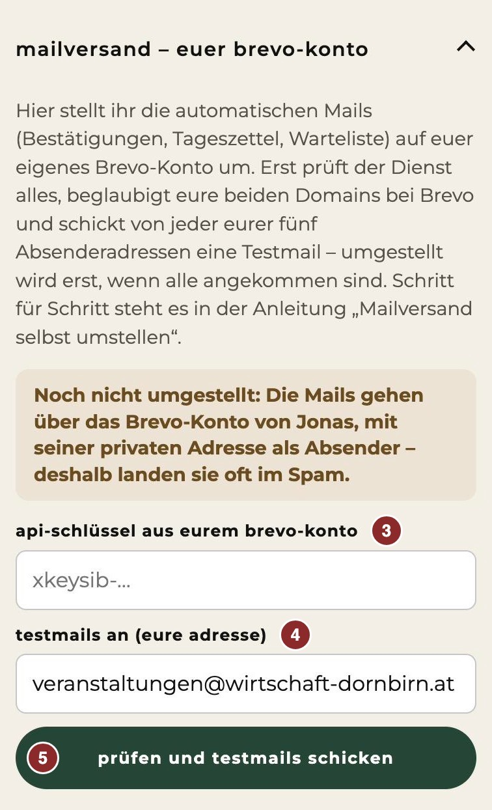
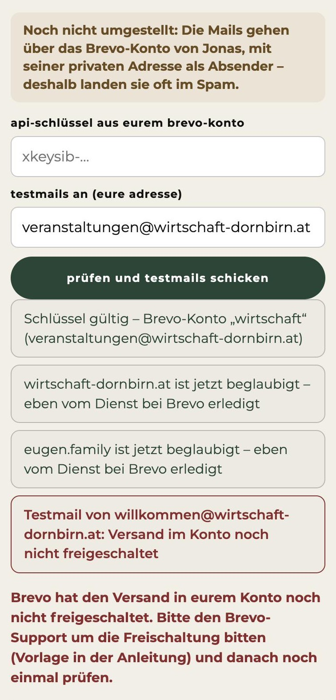

# Mailversand selbst umstellen · Anleitung für Sarah und Hannah

Stand 15. November 2026. **Worum es geht:** Die Mails der Webseite – Bestätigungen für Gäste,
Takeaway, Warteliste und der Tageszettel – kommen heute noch von einer
privaten Adresse von Jonas. Darum landen sie oft im Spam. Nach dieser
Anleitung kommen sie von euren eigenen Adressen, zum Beispiel
`service@wirtschaft-dornbirn.at`.

- **Wer:** eine von euch beiden – wer sich bei Brevo anmelden kann. Jonas
  braucht ihr dafür nicht.
- **Dauer:** etwa 20 Minuten.
- **Kosten:** keine.
- **Risiko:** keines. Umgestellt wird erst ganz am Ende, nach einer Probe.
  Bis dahin läuft alles wie bisher, und mit einem Knopf geht es jederzeit
  zurück.

## So läuft es ab

1. **In Brevo einen Schlüssel erzeugen.** Etwa 5 Minuten.
2. **Den Schlüssel in der Wirt-Ansicht einfügen und prüfen lassen.** Dabei
   beglaubigt die Webseite eure Domains bei Brevo selbst. Etwa 2 Minuten.
3. **Im Postfach fünf Testmails ansehen und umstellen.** Etwa 5 Minuten.
4. **In Brevo die IP-Sperre ausschalten.** Etwa 2 Minuten.

Am besten druckst du diese Anleitung aus oder öffnest sie auf einem zweiten
Gerät. Dann kannst du Punkt für Punkt abhaken.

## Bevor du anfängst

- [ ] Du kannst dich bei **Brevo** anmelden – in euer Konto, das Sarah Anfang
  November angelegt hat.
- [ ] Du hast ein Gerät, auf dem die **Wirt-Ansicht** läuft (Handy, Tablet
  oder Laptop).
- [ ] Du kannst in ein **Postfach** schauen, zum Beispiel
  `veranstaltungen@wirtschaft-dornbirn.at`. Dorthin gehen gleich fünf
  Testmails.

**Mach alles auf dem Gerät, auf dem die Wirt-Ansicht läuft.** Öffne Brevo dort
im Browser. Dann kopierst du den Schlüssel in Brevo und fügst ihn gleich in
der Wirt-Ansicht ein – er muss nirgends sonst hin.

## Schritt 1 – In Brevo einen Schlüssel erzeugen

Der Schlüssel ist eine lange Zeichenfolge. Mit ihm darf die Webseite über
euer Brevo-Konto Mails verschicken. Er ist geheim wie ein Passwort.

1. Im Browser diese Adresse öffnen:
   [app.brevo.com/settings/keys/api](https://app.brevo.com/settings/keys/api).
   Fragt Brevo nach der Anmeldung: anmelden. Du landest auf der Seite
   **API-Schlüssel & MCP** (API Keys & MCP). Klappt der Link nicht: in Brevo
   unten links **Einstellungen** (Settings) → **SMTP & API** →
   **API-Schlüssel & MCP**.
2. Auf **API-Schlüssel generieren** (Generate API key) klicken.
3. Brevo schickt dir einen Code mit 6 Ziffern. Den Code eintippen und auf
   **Bestätigen** (Verify) klicken.
4. Bei **Name** (Key name) eintragen: `Webseite wirtschaft-dornbirn`
5. Bei **Ablauf** (Expiry) **Kein Ablaufdatum** (No expiration) wählen.
6. Bei **Zugriff** (Access) **Eingeschränkt** (Restricted) wählen. Jetzt
   erscheint eine Liste mit vielen Zeilen. Du änderst **genau zwei** davon,
   alle anderen bleiben auf **None**:

| In dieser Zeile | wählst du |
| --- | --- |
| **Transactional email** | **All** |
| **Account** | **Read/write** |

7. Den Schalter **MCP** (Create MCP server API key) nicht anrühren. Er bleibt
   aus.
8. Auf **Generieren** (Generate) klicken. Jetzt steht der Schlüssel da. Er
   beginnt mit `xkeysib-`. Den ganzen Schlüssel **kopieren**.
9. Brevo zeigt den Schlüssel nur dieses eine Mal. Das Fenster offen lassen
   und gleich mit Schritt 2 weitermachen.

**Den Schlüssel nie weitergeben** – nicht per Mail, Chat oder Foto, auch nicht
an Jonas. Er gehört nur in die Wirt-Ansicht.

## Schritt 2 – Den Schlüssel in der Wirt-Ansicht prüfen lassen

1. Die Wirt-Ansicht öffnen und unten auf **haus** tippen.
2. Ganz nach unten scrollen und auf **Mailversand – euer Brevo-Konto**
   tippen. Der Kasten klappt auf. Steht der Punkt nicht da: die Wirt-Ansicht
   neu laden oder die App schließen und wieder öffnen.

3. Bei **API-Schlüssel aus eurem Brevo-Konto** den Schlüssel einfügen.
4. Bei **Testmails an** die Adresse eintragen, in die du gleich
   hineinschaust.
5. Auf **Prüfen und Testmails schicken** drücken und ein paar Sekunden
   warten.

**Das siehst du jetzt:** eine Liste mit acht Zeilen und darunter den Knopf
**Alle Testmails sind da – jetzt umstellen**. Bei den beiden Domains steht
„eben vom Dienst bei Brevo erledigt“: Die Webseite beglaubigt dabei eure
beiden Domains selbst bei Brevo – in Brevo musst du dafür nichts anklicken.
Das Schlüsselfeld ist wieder leer; das ist richtig so.

**Steht eine Zeile in Rot?** Dann stimmt noch etwas nicht. Was zu tun ist,
steht direkt darunter und im Abschnitt „Wenn etwas rot ist“. Am laufenden
Versand hat sich nichts geändert.

## Schritt 3 – Testmails ansehen und umstellen

1. Das Postfach öffnen, das du bei **Testmails an** eingetragen hast. Auch im
   **Spam-Ordner** nachsehen.
2. Dort sind **fünf Testmails**, Betreff „Testmail 1 von 5 – Absender …“ bis
   „Testmail 5 von 5 – Absender …“. Bei jeder Mail nachsehen: Steht als
   **Absender genau die Adresse aus dem Betreff**? Dann abhaken:

- [ ] `willkommen@wirtschaft-dornbirn.at`
- [ ] `service@wirtschaft-dornbirn.at`
- [ ] `veranstaltungen@wirtschaft-dornbirn.at`
- [ ] `tickets@eugen.family`
- [ ] `uri@eugen.family`

3. Alle fünf abgehakt? Dann in der Wirt-Ansicht auf **Alle Testmails sind da
   – jetzt umstellen** drücken (die 3 im Bild oben).
4. Zurück in Brevo: das Fenster mit dem Schlüssel schließen
   (**I've saved my key**).

**Das siehst du jetzt:** Oben im Kasten steht grün „Umgestellt: Seit … gehen
alle Mails über euer Brevo-Konto …“ – mit allen fünf Adressen.

**Fehlt eine Testmail oder steht ein falscher Absender da?** Nicht umstellen.
Auf **Abbrechen** drücken, zehn Minuten warten und Schritt 2 noch einmal
machen (Punkt 3 bis 5). Eine Prüfung gilt zwei Stunden; danach noch einmal
prüfen lassen.

## Schritt 4 – In Brevo die IP-Sperre ausschalten

Brevo kann Zugriffe von unbekannten Geräten sperren. Die Webseite verschickt
aber von wechselnden Adressen – eine Sperre würde den Versand eines Tages
anhalten. Deshalb einmal ausschalten:

1. Im Browser diese Adresse öffnen:
   [app.brevo.com/security/authorised_ips](https://app.brevo.com/security/authorised_ips).
   Klappt der Link nicht: in Brevo unten links **Einstellungen** →
   **Sicherheit** (Security) → **Autorisierte IPs** (Authorized IPs).
2. Unter **Blockieren nicht autorisierter IP-Adressen** (Blocking
   unauthorized IP addresses) die Zeile **API-Schlüssel** (API keys) suchen.
3. Steht dort **Deaktiviert** (Deactivated): nichts tun, fertig.
4. Steht dort **Aktiviert** (Activated): auf **Deaktivieren für API**
   (Deactivate for API) klicken und dann auf **Blockierung deaktivieren**
   (Deactivate blocking).

**Wichtig für später:** Kommt 30 Tage lang keine neue Adresse dazu, schaltet
Brevo diese Sperre von selbst ein und schickt eine Mail, dass eine
IP-Adresse gesperrt wurde. Dann in dieser Mail **die automatische IP-Sperre
deaktivieren** (Deactivate the automatic IP blocking) wählen. Das ist normal.

## Fertig – so prüfst du es

- [ ] In der Wirt-Ansicht ist der Kasten **Mailversand** grün und sagt
  „Umgestellt“.
- [ ] In Brevo steht die IP-Sperre bei **API-Schlüssel** auf **Deaktiviert**.
- [ ] In der Gruppe kurz Bescheid geben: „Mailversand ist umgestellt.“

Ab jetzt kommt jede Mail von ihrer eigenen Adresse:

| Mail | kommt von |
| --- | --- |
| Reservierung, Absage, Takeaway, Warteliste Mittagstisch | `service@wirtschaft-dornbirn.at` |
| Warteliste eines Abends in der „wirtschaft“ | `veranstaltungen@wirtschaft-dornbirn.at` |
| Warteliste eines Abends im Kulturhaus | `tickets@eugen.family` |
| Terminliste („Bleibt auf dem Laufenden“) | `uri@eugen.family` |
| alles andere: Tageszettel, Wochenbericht, Mittagskarte, Anfragen | `willkommen@wirtschaft-dornbirn.at` |

Antwortet ein Gast, landet die Antwort bei dieser Adresse. Nur Antworten auf
die Bestätigung einer Anfrage (Locations, Agentur) gehen an
`uri@eugen.family`.

Unter **Mailversand** in der Wirt-Ansicht steht ab jetzt, wann zuletzt eine
Mail hinausging – und falls einmal etwas nicht klappt, was es war.

## Wenn etwas rot ist

Was rot dasteht, und was du tust. Am laufenden Versand hat sich in diesem
Fall nichts geändert. Nach jeder Lösung: Schritt 2 noch einmal (Punkt 3
bis 5).

| Was rot dasteht | Was du tust |
| --- | --- |
| Versand im Konto noch nicht freigeschaltet | Brevo muss euer Konto erst freischalten. Die Vorlage unten an den Brevo-Support schicken. Die Antwort kommt meist in ein bis zwei Werktagen. |
| … Der Schlüssel darf die Domain nicht beglaubigen | In Brevo beim Schlüssel auf die drei Punkte → **Edit API key**, Code eingeben, bei **Account** **Read/write** wählen und speichern. Dann den Schlüssel noch einmal einfügen. Hast du ihn nicht mehr: Schritt 1 noch einmal. |
| Dem Schlüssel fehlen Rechte | Wie in der Zeile darüber, aber bei **Transactional email** **All** und bei **Account** **Read/write** wählen. |
| … Brevo findet noch nicht alle Einträge (fehlt: …) | In ein paar Stunden noch einmal prüfen. Bleibt es so: Markus fragen. Er vergleicht die genannten Einträge bei Hetzner mit denen in Brevo (Brevo → Domains → die Domain). |
| … ist noch nicht beglaubigt | In einer Stunde noch einmal prüfen. |
| … steht nicht in eurem Brevo-Konto | In Brevo unter **Domains** auf **Domain hinzufügen** (Add a domain) und die Domain eintragen. Die Einträge bei Hetzner stehen schon. |
| Brevo kennt den Schlüssel nicht | Den Schlüssel noch einmal ganz kopieren und einfügen – oder Schritt 1 noch einmal. |
| Das ist ein SMTP-Schlüssel | Falscher Schlüssel: Es braucht einen API-Schlüssel, wie in Schritt 1. |
| Absender nicht angenommen | In Brevo unter **Absender, Domains, IPs** → **Absender** (Senders) → **Absender hinzufügen** (Add a sender) die genannte Adresse eintragen. |
| IP-Sperre bei Brevo | Schritt 4 machen. |
| Zu viele Versuche | Eine Stunde warten. |
| Störung bei Brevo · Brevo bremst gerade · nicht erreichbar | Nichts ist kaputt. In ein paar Minuten noch einmal. |
| Konto bei Brevo gesperrt oder in Prüfung | Im Postfach nach einer Mail von Brevo suchen, die den Grund nennt. Sonst den Brevo-Support fragen. |
| Brevo hat die Anfrage abgelehnt | Später noch einmal. Bleibt es so: den Brevo-Support fragen und die Uhrzeit dazuschreiben. |
| Inzwischen wurde neu geprüft | Jemand hat auf einem anderen Gerät auch geprüft. Die neuesten Testmails ansehen, dann umstellen. |

**Vorlage für den Brevo-Support.** In Brevo über das Hilfe-Menü
(Fragezeichen) → **Support** – oder direkt über
[diesen Link zum Brevo-Support](https://login.brevo.com/?target=https://account-app.brevo.com/account/zendesk-support).
Dort ein Ticket mit diesem Text anlegen:

> Betreff: Freischaltung des Transaktionsversands über die API
>
> Guten Tag, bitte schalten Sie für unser Konto den Versand von
> Transaktions-E-Mails über die API frei. Unsere Webseite (künftig
> www.wirtschaft-dornbirn.at, derzeit wirtschaft-dornbirn.pages.dev)
> verschickt Bestätigungen für Tischreservierungen, Takeaway-Bestellungen
> und Wartelisten sowie einen täglichen Bericht an uns selbst – etwa 40 bis
> 80 Mails am Tag, keine Werbung. Absender sind willkommen@, service@ und
> veranstaltungen@wirtschaft-dornbirn.at sowie tickets@ und uri@eugen.family;
> beide Domains sind in unserem Konto authentifiziert. Vielen Dank!

## Zurück zum alten Versand

Kommen nach dem Umstellen Bestätigungen nicht an: In der Wirt-Ansicht unter
**Mailversand** auf **Zurück zum bisherigen Versand** drücken. Dann gilt
sofort wieder der alte Weg. Später Schritt 2 und 3 noch einmal machen.

## Gut zu wissen

- Der Schlüssel kann nur zwei Dinge: Mails verschicken und eure Absender und
  Domains einrichten. An Kontakte oder Kampagnen kommt er nicht.
- Die Wirt-Ansicht zeigt ihn nie wieder, nur seine letzten vier Zeichen. In
  keiner Sicherungsdatei steht er.
- **Schlüssel wechseln** (zum Beispiel, wenn er in falsche Hände geraten sein
  könnte): Schritt 1 bis 3 noch einmal. In der Wirt-Ansicht heißt der Knopf
  dann **Neuen Schlüssel prüfen**. Danach den alten Schlüssel in Brevo
  löschen (drei Punkte → **Delete API key**).
- Die Webseite läuft noch im Cloudflare-Konto von Jonas. Wer dieses Konto
  verwaltet, könnte technisch an den Schlüssel – so wie heute schon an die
  Reservierungen. Mit eurem eigenen Cloudflare-Konto (siehe Statusblatt)
  liegt alles bei euch; dort tragt ihr den Schlüssel dann noch einmal genauso
  ein.
- Auf der Testseite lässt sich nichts umstellen, und von dort geht nie eine
  Mail hinaus.
